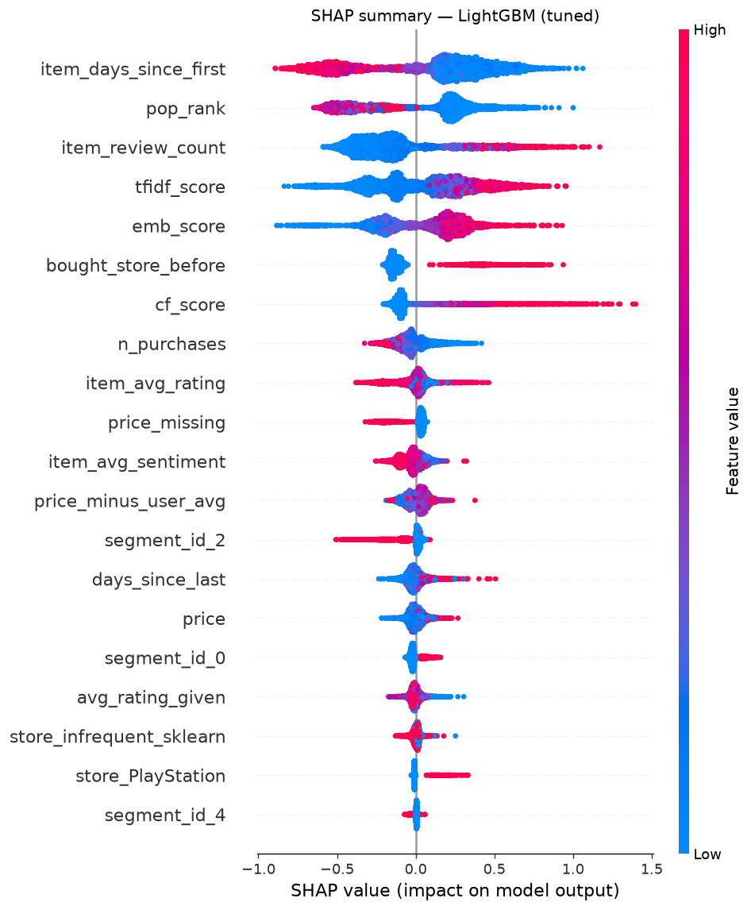

# ShopRank notes

## Phase 1 — Data

Amazon Reviews 2023, Video Games: 4,624,615 reviews, 2,766,656 users, 137,249 products (1998-11 → 2023-09).
Saved to `data/interim/` as Parquet, plus a 10% user sample (276,666 users, 460,834 reviews, `random_state=42`).

## Phase 2 — EDA key findings (10% user sample, `notebooks/02_eda.ipynb`)

- **Ratings are very positive.** 61.2% of reviews are 5★ and 74.6% are ≥4★. "Liked" = rating ≥ 4. A model that always says "liked" is already 74.6% accurate, so accuracy is useless — use ranking metrics (Recall@K, NDCG@K).
- **Strong popularity bias.** The top 1% of products receive 28.8% of reviews, while 43.4% of products have a single review. A most-popular baseline will be hard to beat, and tail items need content features.
- **Most users are one-off.** 72.2% of users wrote one review and only 4.2% wrote ≥5. Only 21.0% of test-period users appear in train, so cold start is the main problem, not a corner case.
- **The user × product table is 99.9973% empty** (density 0.0027%). Dense storage would need 67 GB, so use `scipy.sparse`. 6,822 duplicate (user, product) pairs must be deduplicated.
- **Time split (before 5-core): train < 2022-07-01, val 2022-07-01 → 2022-12-31, test ≥ 2023-01-01** (91.6% / 4.4% / 3.9%). Activity peaks in 2020; December + January hold 23.3% of reviews; 2023 tails off because collection ended in Sept 2023.
- **Product metadata has gaps.** Price is missing for 46.9% of products, description is empty for 35.7%, features for 22.3%, categories for 6.7%, store for 1.8%. Empty lists hide from `isna()`. Plan: impute price by platform median + a `price_missing` flag; fall back to title for text.
- **Outliers exist.** Prices run up to $3,499.99 with 32 items at ≤ $0.01; one user posted 78 reviews in a single day and 435 user-days have ≥10 reviews (bot-like). Plan: clip/log price, flag burst users. Price is nearly uncorrelated with everything (Spearman ≤ 0.17), while review count and helpful votes overlap (0.61–0.65) — keep one popularity count.
- **Category and verified status matter, but weakly.** Platform vs liked: χ² p < 0.001 but Cramér's V = 0.087 (Switch 81.0% liked vs PC 70.2%). Verified buyers (86.3% of reviews) like 75.9% vs 66.0% for unverified (mean 4.10 vs 3.73). Keep both as features; don't filter out unverified reviews.

## Phase 3 — Clean + time split (`notebooks/03_clean_split.ipynb`, full data)

**Split dates: T1 = 2022-07-01 (val starts), T2 = 2023-01-01 (test starts).**
The guide's T1 = 2023-06-01 / T2 = 2023-08-01 leaves only 82 test interactions after the 5-core filter (10 scorable users), because the last months of 2023 are nearly empty.

| Step | Interactions |
|---|---|
| Raw | 4,624,615 |
| Exact duplicates removed | 4,570,966 |
| Keep latest per (user, product) | 4,555,500 |
| From 2018-01-01 | 2,374,766 |
| 5-core | **184,567** (24,243 users, 9,999 products, 83.3% liked) |

| Split | Interactions | Users | Products | Dates | Users to score (warm / cold) |
|---|---|---|---|---|---|
| Train | 149,524 (81.0%) | 22,324 | 8,519 | 2018-01-01 → 2022-06-30 | — |
| Val | 21,327 (11.6%) | 6,939 | 4,696 | 2022-07-01 → 2022-12-31 | 4,549 / 1,495 |
| Test | 13,716 (7.4%) | 4,686 | 3,917 | 2023-01-01 → 2023-09-02 | 2,686 / 1,428 |

- warm = in train and ≥1 liked product in the window (main metric); cold = liked something in the window but has no train history.
- Items: `price` gaps filled with median $27.97 + `price_missing` flag (24.3% of products); `store` gaps → "unknown" (0.2%); `item_text` = title + features + description, lowercased, HTML stripped.
- Metadata `average_rating` / `rating_number` dropped; replaced by `train_rating_count`, `train_avg_rating`, `train_liked_rate` from train reviews only. 14.8% of products have no train reviews (they first appear in val/test).
- The 5-core filter is applied before splitting, so it uses future activity to decide which users/products to keep — standard practice, but note it when comparing to production.

**Leakage rules**
- Every feature uses only data from before the cutoff.
- Fit scalers, encoders, TF-IDF and K-Means on train only; `.transform()` val and test.
- Never use metadata `average_rating` / `rating_number`; use the `train_*` columns.
- Never shuffle rows across time.

Outputs in `data/processed/`: `train.parquet`, `val.parquet`, `test.parquet`, `items.parquet`, `eval_users.parquet`.

## Phase 4 — Evaluation harness + baselines (`notebooks/04_baselines.ipynb`)

- Metrics in `src/shoprank/evaluation/metrics.py`; tests in `tests/test_metrics.py` (`python -m pytest`).
- Hand check: recommended = [A, B, C], liked = {B} → Recall@3 = 1.0, NDCG@3 = 0.6309 = 1/log2(3). ✔
- `evaluate()` removes products the user already bought in train before taking the top K.
- Scored on the validation window (2022-07-01 → 2022-12-31). Coverage = share of the 9,999-product catalog shown to anyone.
- Warm users: 4,549 (median 1 liked val product each, mean 2.37). Cold users: 1,495.

## Results (validation, warm users, K = 10)

| Model | Recall@10 | NDCG@10 | HitRate@10 | Coverage |
|---|---|---|---|---|
| Random | 0.0005 | 0.0004 | 0.0018 | 98.78% |
| Popular (all time) | 0.0127 | 0.0071 | 0.0286 | 0.16% |
| Trending (last 30 days) | 0.0251 | 0.0164 | 0.0517 | 0.13% |

Cold users (no train history), same window: Popular Recall@10 0.0110 / NDCG@10 0.0092; Trending 0.0142 / 0.0112.
Trending (1,454 likes on 1,023 products in June 2022, ties broken by all-time popularity) is the baseline to beat.

## Phase 5 — Retrieval (`notebooks/05_retrieval.ipynb`, code in `src/shoprank/retrieval/`)

- Sparse user × product matrix from train: 22,324 × 9,999, 149,524 filled (0.067%), 1.3 MB vs 0.89 GB dense. Columns cover all 9,999 products so text sources can reach products first seen after T1.
- Sources, all fit on train only: item-KNN (cosine, 50 neighbours), TF-IDF (1–2-grams, min_df 3, 50k features, fit on the 8,519 train products), `all-MiniLM-L6-v2` embeddings (cached in `data/processed/item_embeddings.npy`, 26 s on MPS), trending popularity.
- User profile = average vector of liked train products (464 users with no liked product fall back to all their products).
- Equal quotas waste the strongest source: 25 from each (~91 products) gets 0.1007, *below* trending@100 alone. Giving popularity a bigger share fixes it.

| Retrieval (validation, 4,549 warm users) | Recall | Avg candidates |
|---|---|---|
| Item-KNN @100 | 0.0575 | 100 |
| TF-IDF @100 | 0.0770 | 100 |
| Embeddings @100 | 0.0626 | 100 |
| Trending @100 | 0.1028 | 100 |
| Union 25/25/25/25 | 0.1007 | 91 |
| Union 20/20/10/50 (cf/tfidf/emb/pop) | 0.1112 | 95 |
| **Union 30/30/30/75 — saved** | **0.1477** | 153 |
| Union 50/50/50/50 | 0.1484 | 179 |

- 10% user sample run first: same ordering (trending 0.1270 > TF-IDF 0.0913 > embeddings 0.0644 > item-KNN 0.0519; saved union 0.1767).
- TF-IDF beats embeddings (0.0770 vs 0.0626), likely because product titles carry exact platform and franchise words that bag-of-words matches directly.
- Every source adds products no other source finds (in the saved candidates): pop 744, cf 169, tfidf 157, emb 102.
- `data/processed/candidates_val.parquet`: 696,065 rows, 4,549 users, 124–165 candidates each, columns `cf_score`, `tfidf_score`, `emb_score`, `pop_rank`, `label` (liked in val; 0.20% positive).

## Phase 6 — Supporting models

### A. Sentiment (`notebooks/06a_sentiment.ipynb`)
4–5★ = positive, 1–2★ = negative, 3★ dropped. TF-IDF (1–2-grams, min_df 5, 183k terms, **no stop-word list** — it would delete "not"), fit on 139,115 train reviews; scored on 19,792 validation reviews (90.8% positive).

| Model | Accuracy | F1 pos | F1 neg | Macro F1 | PR-AUC neg |
|---|---|---|---|---|---|
| Always positive | 0.9081 | 0.9518 | 0.0000 | 0.4759 | 0.0919 |
| Multinomial NB | 0.9572 | 0.9767 | 0.7349 | 0.8558 | 0.8305 |
| Logistic Regression (balanced) | 0.9569 | 0.9760 | 0.7892 | 0.8826 | 0.8912 |
| LinearSVC | 0.9683 | 0.9827 | 0.8122 | 0.8975 | 0.8996 |

- LinearSVC is best, but `avg_sentiment` uses Logistic Regression because it gives probabilities.
- Train reviews get **out-of-fold** probabilities (5 folds) so `avg_sentiment` isn't inflated by in-sample fit; 3★ reviews average 0.491 positive.
- `data/processed/item_sentiment.parquet`: `avg_sentiment` for all 9,999 products (1,480 without train reviews → 0.822). Correlation with `train_avg_rating` is 0.873, so the ranker may find it largely redundant.
- Caveat: Amazon auto-titles like "Five Stars" / "Two Stars" leak the label into the text and inflate the scores somewhat.
- Stretch goal (DistilBERT) not done.

### B. Rating regression from scratch (`notebooks/06b_rating.ipynb`)
Features: user avg rating, product avg rating, price, `avg_sentiment`. Train rows use **leave-one-out** averages (a review's own rating/sentiment never feeds its features); validation rows use train averages. Standardized with a train-fit `StandardScaler` (on raw features lr=0.01 diverges to 1e220 because of price).

- Learning rates (1,000 steps): 0.001 still descending (MSE 1.417), 0.01 converges (1.064), 0.1 converges in ~20 steps (1.064), 1.0 diverges. Plot: `reports/figures/rating_gd_lr.png`.

| Model (validation, clipped to 1–5) | RMSE | MAE |
|---|---|---|
| Global mean | 1.0907 | 0.8390 |
| **GD from scratch (lr=0.1)** | **1.0696** | **0.7877** |
| sklearn LinearRegression | 1.0696 | 0.7877 |
| Ridge | 1.0696 | 0.7877 |
| GradientBoostingRegressor | 1.0671 | 0.7904 |

- GD weights equal sklearn's to 4 decimals. Gains over the global mean are small: user average dominates (weight 0.45), price barely matters (0.01).
- Saved to `models/rating_gd.joblib` (scaler + weights) for the dashboard's "expected rating".

### C. User segments (`notebooks/06c_segments.ipynb`)
Features per train user as of T1: purchases, days since last purchase, avg known price paid, avg rating given, verified share, distinct stores. `log1p` on the long-tailed four, then `StandardScaler`, K-Means k = 2…10.
- Silhouette ≈ 0.18–0.22 for every k (overlapping groups, no clear elbow). Best in 4–6 is **k = 6** (0.207).

| Segment | Users | Purchases | Days since last | Avg price | Avg rating | Verified |
|---|---|---|---|---|---|---|
| Budget buyers, lapsed | 8,061 | 5.8 | 661 | $30 | 4.62 | 97% |
| Premium buyers, lapsed | 4,935 | 5.9 | 635 | $108 | 4.60 | 96% |
| Frequent multi-store buyers | 3,039 | 13.6 | 375 | $52 | 4.46 | 94% |
| Critical raters | 2,925 | 5.3 | 361 | $61 | 2.90 | 90% |
| Light buyers | 1,849 | 2.4 | 413 | $39 | 4.54 | 95% |
| Unverified reviewers | 1,515 | 8.1 | 376 | $61 | 4.16 | 15% |

- PCA: PC1 (32%) = activity (purchases, stores), PC2 (21%) = rating + verified + recency. Plot: `reports/figures/segments_pca.png`.
- `data/processed/user_segments.parquet`: `segment_id`, `segment_name` and the six features for 22,324 train users. Users not in train → `segment_id = -1` in Phase 7.

## Phase 7 — Ranker data (`notebooks/07_ranker_data.ipynb`, code in `src/shoprank/ranking/`)

Both copies come from one function, `build_snapshot(interactions, cutoff, label_end)`, which refits item-KNN, TF-IDF, embedding profiles and trending on the history before its cutoff and recomputes every feature from that history. Phase 6 models fit on train only (sentiment classifier → `models/sentiment_lr.joblib`, segment scaler + K-Means → `models/segments.joblib`) are reused with `.predict()`.

| Copy | Features from | Labels from | Rows | Users | Positive rate |
|---|---|---|---|---|---|
| `ranker_train.parquet` | before 2022-07-01 | 2022-07-01 → 2022-12-31 | 174,135 | 1,141 | **0.81%** |
| `ranker_test.parquet` | before 2023-01-01 | 2023-01-01 → end | 571,098 | 3,719 | **0.22%** |

- Users scored = seen before the cutoff and liked ≥1 product in the label window. For the test copy "seen" means train **or** validation, so it has 3,719 users (vs 2,686 when counting train only in Phase 3).
- Candidate recall: train copy 0.1477 (matches Phase 5 exactly), test copy 0.1417.
- Only 25% (train) / 26% (test) of users have any liked product among their candidates. The training copy drops the other 3,408 users (696,065 → 174,135 rows); the test copy keeps them, so test Recall@K can never exceed ~0.14.
- Val/test review sentiment comes from the train-fit classifier; train reviews keep out-of-fold scores.
- **Leakage test** (`tests/test_leakage.py`): rebuilds the T1 copy with every row on/after T1 scrambled (ratings, sentiment, verified flag, plus 2,000 fake future purchases). All 18 features are identical for matching (user, product) rows; labels change. Sanity check: deliberately computing product stats from all rows makes the test fail on `item_review_count`.

**Feature selection (training copy)**
- Correlation heatmap (`reports/figures/ranker_feature_corr.png`): no pair above |r| 0.9. Strongest: item_avg_rating vs item_avg_sentiment 0.857, price vs price_minus_user_avg 0.784, tfidf vs emb 0.735.
- Pearson with label: all |r| < 0.05 (0.8% positives); strongest bought_store_before 0.045, item_review_count 0.036, tfidf/cf/emb ≈ 0.023.
- Chi-square: 26 of 51 store columns and 2 of 6 segment columns significant at p < 0.05 (PlayStation store χ² = 144).

**Final features (17):** n_purchases, avg_rating_given, days_since_last, segment_id · item_review_count, item_avg_rating, item_avg_sentiment, price, price_missing, store, item_days_since_first · cf_score, tfidf_score, emb_score, pop_rank, price_minus_user_avg, bought_store_before.
- Dropped `avg_price_paid`: exactly price − price_minus_user_avg (the three columns have rank 2) and the weakest label correlation (−0.0001).
- Weak-screen features (item_avg_rating, item_avg_sentiment, days_since_last) are kept for the Phase 8 importance/SHAP recheck.
- Preprocessing: `shoprank.ranking.preprocess.make_preprocessor()` — StandardScaler on numeric, one-hot segment_id and the top 50 stores (rest → "infrequent"); fit on the training copy only. 1.8% of test rows have a store never seen in train.

## Phase 8 — Rankers (`notebooks/08_rankers.ipynb`, MLflow experiment `shoprank-ranker`)

- MLflow: `mlflow ui --backend-store-uri sqlite:///mlflow.db` from the project root → http://localhost:5000. 13 runs logged (params, CV + test metrics, model). Models are logged with cloudpickle (MLflow's default skops format rejects the calibrated SVM).
- Training copy: 5-fold `GroupKFold` by user. Test copy: ranking metrics count every product liked in the test window, so retrieval misses count against the ranker (ceiling ≈ 0.14 recall).
- **Winner chosen by CV NDCG@10 (training copy), not by test**: LightGBM (tuned). On test it is essentially tied with the tuned random forest (0.0319 vs 0.0322).
- CV NDCG@10 is much higher than test NDCG@10 because every training-copy user has ≥1 positive candidate, while 74% of test users have none.

| Model | CV AP | CV NDCG@10 | Train AP | Test ROC-AUC | Test PR-AUC | Test log loss | Test Recall@10 | **Test NDCG@10** | Test coverage |
|---|---|---|---|---|---|---|---|---|---|
| **LightGBM (tuned) — winner** | 0.0559 | **0.1517** | 0.2455 | 0.7790 | 0.0094 | 0.0167 | 0.0482 | **0.0319** | 26.0% |
| Voting (soft: RF, LightGBM, SVM) | 0.0492 | 0.1488 | 0.6577 | 0.7672 | 0.0087 | 0.0183 | 0.0463 | 0.0301 | 23.5% |
| Random forest (tuned) | 0.0509 | 0.1479 | 0.4512 | 0.7619 | 0.0108 | 0.0184 | 0.0490 | 0.0322 | 24.9% |
| Stacking (same 3 + LR) | 0.0507 | 0.1475 | 0.7207 | 0.7677 | 0.0088 | 0.0183 | 0.0465 | 0.0301 | 23.5% |
| Random forest | 0.0509 | 0.1473 | 0.8401 | 0.7504 | 0.0097 | 0.0202 | 0.0469 | 0.0312 | 23.6% |
| LGBMRanker (lambdarank) | 0.0523 | 0.1433 | 0.1745 | 0.7636 | 0.0086 | — | 0.0473 | 0.0299 | 25.8% |
| LightGBM | 0.0459 | 0.1383 | 0.5847 | 0.7682 | 0.0077 | 0.0176 | 0.0448 | 0.0271 | 26.7% |
| Linear SVM (calibrated) | 0.0302 | 0.1049 | 0.0305 | 0.7249 | 0.0069 | 0.0179 | 0.0415 | 0.0250 | 23.4% |
| Logistic regression (balanced) | 0.0291 | 0.1023 | 0.0293 | 0.7316 | 0.0068 | 0.5890 | 0.0406 | 0.0245 | 20.7% |
| KNN (50K-row sample) | 0.0241 | 0.1014 | 0.0494 | 0.6400 | 0.0041 | 0.0254 | 0.0308 | 0.0182 | 35.0% |
| Decision tree (depth 8) | 0.0258 | 0.0976 | 0.1102 | 0.7124 | 0.0056 | 0.0225 | 0.0374 | 0.0222 | 32.5% |
| Decision tree (depth 3) | 0.0194 | 0.0966 | 0.0226 | 0.5901 | 0.0038 | 0.0173 | 0.0338 | 0.0199 | 17.1% |
| Decision tree (no limit) | 0.0092 | 0.0471 | 1.0000 | 0.5095 | 0.0023 | 0.2584 | 0.0119 | 0.0075 | 20.7% |
| *Trending (popularity baseline)* | | | | | | | 0.0259 | 0.0171 | 0.13% |
| *Candidates sorted by retrieval score alone (best: pop_rank)* | | | | | | | 0.0259 | 0.0171 | 0.13% |
| *… by cf_score / tfidf_score / emb_score* | | | | | | | 0.018 / 0.018 / 0.014 | 0.011 / 0.010 / 0.009 | 58–72% |

- **The ranker adds value**: test NDCG@10 0.0319 vs 0.0171 for both trending and the best retrieval score alone (+87%), with 26% catalog coverage instead of 0.13%.
- Overfitting is visible in the trees: unlimited depth reaches train AP 1.00 but CV AP 0.009; depth 8 is the sweet spot for a single tree.
- Tuning (RandomizedSearchCV 30 tries → GridSearchCV, AP, 3-fold GroupKFold): LightGBM AP 0.0500 → 0.0523 (num_leaves 29, learning_rate 0.0145, n_estimators 473, min_child_samples 162, subsample 0.76, colsample_bytree 0.56); random forest test NDCG 0.0312 → 0.0322. LightGBM early stopping on a 20% user slice picked 200 trees for the untuned model.
- Ensembles of untuned models did not beat the tuned single models. LambdaRank (stretch) reached test NDCG 0.0299, below the tuned classifier.
- Logistic regression's log loss (0.589) is poor because `class_weight="balanced"` deliberately shifts its probabilities; its ranking is unaffected.

**SHAP (winner, 5,000 test rows)** — `reports/figures/shap_summary.png`

- Top drivers by mean |SHAP|: item_days_since_first 0.371 (newer products score higher), pop_rank 0.319 (trending), item_review_count 0.280, tfidf_score 0.267, emb_score 0.232, bought_store_before 0.172, cf_score 0.165.
- User-only features (n_purchases, days_since_last, segment) matter little, as expected: they are constant within a user's list. item_avg_sentiment (0.053) adds little beyond item_avg_rating, as Phase 6 predicted.
- Registered as **`shoprank-ranker` version 1** in the MLflow registry; also saved to `models/ranker.joblib`.

## Phase 9 — Pipeline (`src/shoprank/pipeline.py`, `config.yaml`, `Makefile`)

- **One command rebuilds everything from the raw files:** `make train`, which runs `python -m shoprank.pipeline --config config.yaml`. It takes about 3.5 minutes on the M-series Mac (load 35 s, clean 17 s, split 1 s, retrieval incl. embeddings 34 s, features 73 s, train 3 s, evaluate 4 s, export 31 s). `--stages features,train` reruns a subset; each stage reads its inputs from disk.
- **Settings live in `config.yaml`:** dates, k-core, retrieval quotas, TF-IDF/KNN/embedding settings, sentiment/rating/segment settings, and the tuned LightGBM parameters from Phase 8. `random_state: 42` is passed to every sampler, fold splitter and model.
- **Setup:** `make install` (requirements plus `pip install -e .`, so `shoprank` imports from anywhere). `make test` runs pytest. `make api` and `make app` print a message until Phase 10/11 add `api/main.py` and `app/app.py`.
- **Code moved out of notebooks into `src/shoprank/`:**
  - `data/load.py`, `data/clean.py`, `data/split.py` (notebooks 01 and 03).
  - `retrieval/embeddings.py` (cached encoding).
  - `nlp/sentiment.py` (fit, out-of-fold scores, per-product table).
  - `ranking/rating.py` (leave-one-out features, gradient-descent model).
  - `ranking/train.py` (final ranker, test metrics, baselines).
  - `config.py`.
  - `ranking/dataset.build_snapshot` now takes its retrieval settings from the config, and has a serving mode (`all_users=True`) that scores every known user.
- **Notebooks 01, 03, 05, 06a, 06b and 07 now import these functions** and read dates and paths from `config.yaml`. They were rerun and give the same outputs. Notebooks 02, 04, 06c and 08 already used `src/` (08 keeps the full model comparison, MLflow and SHAP; the pipeline trains only the winner).
- **Paths that moved:** the embeddings cache is now `models/item_embeddings.npy` (was `data/processed/`), and the sentiment model is now `models/sentiment.joblib` (was `sentiment_lr.joblib`).

**Exports in `models/` (everything the API needs)**

| File | Contents |
|---|---|
| `ranker.joblib` | Whole sklearn Pipeline (preprocessor + tuned LightGBM); input columns `ranking.models.MODEL_INPUT` |
| `candidates.parquet` | Precomputed candidates and all 18 features for every known user (24,243 users, about 153 each, 3.7M rows). History is everything up to the last review, with serving cutoff 2023-09-03. Already-bought products are excluded |
| `item_knn.joblib`, `tfidf.joblib`, `item_embeddings.npy` (+ `_ids.npy`) | Retrieval sources refit on all data, for new or anonymous users. Item order matches `items.json` |
| `sentiment.joblib` | TF-IDF + logistic regression, fit on train reviews |
| `segments.joblib`, `segments.parquet` | Segment model, plus each known user's features, `segment_id` and `segment_name` at serving time |
| `rating_gd.joblib` | Expected-rating model (gradient descent written from scratch) |
| `popular_items.json` | Top 100 trending products (last 30 days), the fallback for cold users |
| `items.json` | parent_asin → title, price, price_missing, store, platform |
| `metadata.json`, `metrics.json` | Model version (timestamp), training time, git commit, split dates, serving cutoff, data sizes, features and parameters, test metrics, baselines, rating metrics |

**Checks (the phase's done criteria)**

- **Deleting outputs and rerunning brings every file back.** I deleted `models/`, `data/processed/` and `data/interim/` and ran `make train`; every file came back.
- **Rebuilt outputs are identical to the notebook outputs.** Every interim and processed parquet matches the copy saved before refactoring, column by column. That covers the split, items, candidates, sentiment, segments and both ranker copies. Embeddings differ by 0.0, the rating model coefficients are identical, and ranker predictions on the test copy differ by 0.0.
- **Pipeline test metrics match notebook 08:**
  - Ranker: NDCG@10 **0.0319**, Recall@10 0.0482, ROC-AUC 0.7790, PR-AUC 0.0094, log loss 0.0167, coverage 26.0%.
  - Trending baseline: NDCG@10 0.0171.
  - Retrieval recall on validation: 0.1477. Rating model on validation: RMSE 1.0696 against 1.0907 for the global mean.
- **Tests:** `make test` runs 23 tests, all passing. The new `tests/test_pipeline_exports.py` checks that every export exists, that candidates score with `ranker.joblib`, that product ids line up across files, and that `metadata.json` holds the version, split dates and test metrics.

## Phase 10 — FastAPI service (`api/`)

- **Run it:** `make api` (`uvicorn api.main:app --reload --port 8000`), then open http://localhost:8000/docs. All five endpoints can be tried from that page.
- **Startup:** FastAPI's `lifespan` loads every file in `models/` once, which takes about 2 s. That covers the ranker, 3.7M precomputed candidate rows, item-KNN similarities, embeddings, the sentiment and rating models, user history and product info. Requests never read from disk.
- **Code:** Pydantic request/response models are in `api/schemas.py`. All the logic is in `api/service.py`, and `api/main.py` holds only the routes.

| Endpoint | What it does |
|---|---|
| `GET /health` | Status, model version, training time, serving cutoff, number of users and products |
| `GET /recommend/{user_id}?k=10` | **Known user:** scores their ~153 precomputed candidates with `ranker.predict_proba`, sorts them and returns the top k with score, title, price and store. The `reason.because_you_bought` field is the product in the user's history whose text embedding is most similar to the recommended one. **New user:** the trending top k with `"strategy": "popular"`, `score: null` and no error |
| `GET /similar/{item_id}?k=10` | Co-purchase neighbours from item-KNN, topped up with text-embedding neighbours when a product has fewer than k. 404 if the product is unknown |
| `POST /sentiment` `{"text": ...}` | Positive or negative label, its probability, and `p_positive` (from the Phase 6 TF-IDF + logistic regression model) |
| `POST /predict-rating` `{"user_id", "parent_asin"}` | Expected stars (1–5) from the Phase 6 gradient-descent model and the features it used. New users get the global average rating as their user average |
| `GET /metrics` | Not built yet; Phase 17 adds it |

- **Validation:** `k` must be an integer from 1 to 50, `text` must be 1–10,000 characters, and ids must be non-empty. Bad input gets FastAPI's automatic 422 response.
- **Prices:** a product with no catalogue price returns `price: null`, not the median that was filled in for the models.
- **Request log:** every request is appended to `logs/predictions.jsonl` with time, endpoint, user or item id, products returned, scores, latency and model version. The path can be changed with `SHOPRANK_PREDICTION_LOG`.
- **Tests:** `tests/test_api.py` has 10 tests covering every endpoint, the 422s and 404s, the popular fallback for new users, that already-bought products are never recommended, and the request log. `make test` now runs 33 tests, all passing.

**Latency** (`make bench`, `scripts/benchmark_api.py`: 100 sequential HTTP requests per endpoint against the local uvicorn server, M-series MacBook)

| Endpoint | p50 | p95 | max |
|---|---|---|---|
| recommend (known user) | 4.0 ms | **5.4–8.2 ms** (two runs) | 24 ms |
| recommend (new user) | 0.6 ms | 0.7 ms | 1.0 ms |
| similar | 0.6 ms | 0.7 ms | 1.0 ms |
| sentiment | 0.7 ms | 0.9–1.0 ms | 1.8 ms |
| predict-rating | 0.9–1.0 ms | 1.2 ms | 1.7 ms |

- All endpoints are far under the 100 ms target. The personalized path is the slowest because it runs the full sklearn Pipeline (ColumnTransformer + 473-tree LightGBM) on about 153 rows per request.

## Phase 11 — Tests and data checks (`tests/`, `make check`)

- **Commands:** `make test` runs pytest, `make lint` runs `ruff check .`, and `make check` runs both. Dev tools (pytest, httpx, pandera, ruff) are in `requirements-dev.txt`, which `make install` also installs.
- **Fixture dataset** (`tests/fixtures/`): 26 raw reviews and 9 products, with users `USER_1`–`USER_7` and products `P01`–`P08` plus `P99`.
  - It spans train, validation and test, and includes an exact duplicate and a pre-2018 review for cleaning to remove.
  - `tests/fixtures/config.yaml` is the same config shrunk to fit: 2-core, 2 segments, quotas 3/3/3/5, a 10-tree LightGBM.
  - `tests/conftest.py` runs **the real pipeline** (load → … → export) on it into a temporary folder in about 0.3 s. Random unit vectors stand in for the sentence embeddings, so tests never download a model. The API and export tests use these tiny models, so they run anywhere.
- **Data checks** (`src/shoprank/data/schemas.py`, Pandera) cover the interactions, items and ranker tables. The pipeline validates every split and ranker table before writing it, so bad data stops the run. The interactions schema requires:
  - ratings to be 1–5;
  - non-empty `user_id` and `parent_asin`;
  - `liked` to be 0/1 and to agree with rating ≥ 4;
  - `helpful_vote` ≥ 0;
  - unique (user, product) pairs.
- **Quality gate** (`src/shoprank/evaluation/gate.py`, thresholds in `config.yaml`): the model must reach test NDCG@10 ≥ 0.025 and ROC-AUC ≥ 0.70, and beat every baseline on NDCG@10. The evaluate stage logs any failures as warnings. The current model passes (0.0319 / 0.779 against 0.0171 for the best baseline).

| Test type | Files | Examples | Runs without full data? |
|---|---|---|---|
| Unit | `test_metrics.py`, `test_retrieval.py`, `test_phase6.py` | `ndcg_at_k(["A","B","C"], {"B"}, 3) ≈ 0.631`; item-KNN, profile scorer, top-N mask, recall; gradient descent vs closed form | yes |
| Data validation | `test_data.py` | cleaning drops the duplicate and the old review; k-core; the schema rejects rating 6 or 0, empty ids, `liked`=2, negative votes, nulls, duplicates and a `liked` that contradicts the rating; real tables pass | yes (real-table check skips) |
| Leakage | `test_leakage.py` | latest train date < T1 ≤ earliest validation date, and val < T2 ≤ test (fixture and real); features identical when everything after T1 is scrambled (real) | partly |
| API | `test_api.py` (`TestClient`, no server) | `/health` 200; `/recommend/USER_1?k=3` returns 3 sorted items with reasons, none already bought; new user gets `popular`; `k` = 0, 51, 500, "ten" → 422; `/similar`, `/sentiment`, `/predict-rating`, 404s; request log written. Runs on the tiny models and again on the real ones | yes (real copy skips) |
| Model quality gate | `test_model_quality.py` | the gate passes a good model and rejects one that loses to trending, has low NDCG or ROC-AUC, or lacks metrics; NDCG@10 in the real `metadata.json` beats the popularity baseline | yes (real check skips) |
| Exports | `test_pipeline_exports.py` | every file the API needs exists; candidates score with the ranker; no already-bought candidates; ids line up across files (tiny and real) | yes |

- **Results:**
  - Full suite: **71 passed in about 32 s** (under a minute). The full-data leakage test takes about 24 s of that.
  - Fresh checkout with no data and no models (what CI will see in Phase 14): 50 passed, 21 skipped, in 0.6 s.
  - `ruff check .`: **no errors**. Rules are E, F, W, I, B, UP with line length 120; notebooks may have long lines and imports after `sys.path.insert`.
- **Fixes along the way:**
  - `top_n_mask` now copes with a quota larger than the catalogue.
  - API 404s use `raise … from None`.
  - Ruff sorted imports and removed unused ones in notebooks 06a, 06c and 08, and renamed a variable `l` in 06b.

## Phase 12 — Streamlit dashboard (`app/`)

- **Run it:** `make api` in one terminal, then `make app` in another, and open http://localhost:8501. `make app` warns if the API is not reachable. The API address comes from `API_URL` (default `http://localhost:8000`).
- **Design:** the dashboard never loads a model. Everything that needs a prediction goes through the API (`app/common.py`: `get`/`post`, with a friendly error box when the API is down). Fixed files that need no model are read directly and cached with `@st.cache_data`: `metadata.json`, `segments.parquet`, `reports/model_comparison.csv`, the SHAP image, and the request log.
- **API additions for the dashboard:**
  - `GET /popular?user_id=` returns the best-seller baseline without the shopper's purchases.
  - `GET /users/{id}/history` returns purchases, newest first, with the shopper's segment.
  - `GET /search?q=` does a title search, most-reviewed first.
  - `/recommend` and `/popular` items now carry `expected_rating` from the rating model.
  - `/sentiment` now returns `predicted_rating`.
- **Predicted rating from text:** isotonic regression maps out-of-fold `p_positive` to stars. It is fitted in the pipeline's features stage and saved as `sentiment.joblib["stars"]`. p = 0.02 / 0.2 / 0.5 / 0.8 / 0.98 maps to 1.8 / 2.6 / 3.6 / 4.4 / 4.8 stars.
- **Segment map:** the export stage adds `pc1`/`pc2` (PCA on the standardised segment features) to `segments.parquet`.

| Page | What it shows |
|---|---|
| Home | One-line pitch; NDCG@10 (+87% vs trending), catalogue coverage (about 200× the baseline), shoppers and products; a three-step "how it works"; links to every page |
| Recommend | Pick one of 20 demo shoppers or paste any id. Shows purchase history on the left and the ShopRank top k with price, score bar, expected stars and "because you bought". The **compare** toggle (on by default) adds the best-seller list beside it, plus overlap and same-store counts. Unknown ids show the trending fallback |
| Similar products | Search a title, pick a product, see its neighbours with a similarity bar and why each one matched (bought together or similar description) |
| Review analyzer | Paste a review or click an example: sentiment, confidence and predicted star rating |
| Customer segments | PCA scatter coloured by segment, segment sizes, and a profile table (purchases, average rating and price, share verified, days since last purchase) |
| Model report | Shipped model's test metrics, NDCG@10 bar chart for all 13 MLflow runs and baselines, the results table and the SHAP summary |
| Monitoring | Drift summary placeholder (Phase 17); requests, per-endpoint latency p50/p95, requests per minute and popular-fallback share from `logs/predictions.jsonl` |

- **Demo users** (`scripts/pick_demo_users.py` → `app/demo_users.json`): 20 shoppers with 5–40 purchases from all six segments (4/4/4/3/3/2). Within each segment, I picked those whose top 10 overlaps least with the best-sellers. 7 share 0 products, 8 share 1 and 5 share 2, so the compare toggle always shows a clear difference.
  - Example ("Budget buyers, lapsed, mostly WolfLawS"): ShopRank recommends WolfLawS/BENGOO/Vimetapro headsets and VR accessories that match the history. The best-sellers are Zelda, SD cards and DualShock controllers. 1 of 10 products is shared, and 9 vs 0 recommendations come from stores the shopper already buys from.
- **Verification:**
  - `tests/test_app.py` starts a real uvicorn server on the tiny fixture models and runs every page (Home plus six) through Streamlit's `AppTest`. All seven render with no exceptions or error boxes.
  - The fixture config now evaluates at k = 10 like the real one, so the Home and Model report pages find `ndcg@10`.
  - `test_api.py` gained tests for `/popular` (excludes bought products), `/users/{id}/history` (newest first, 404 for unknown users), `/search`, and `predicted_rating` ordering.
  - Full suite: **84 passed in about 33 s**. `ruff check .` is clean.
  - Checked by hand in the browser with the real models: every page loads.
- **Fixes along the way:**
  - Long Amazon titles pushed the price and score columns out of view, so tables now shorten titles and fix column widths.
  - Home metric labels were cut off on narrow screens, so labels are shorter and the detail moved into tooltips.
